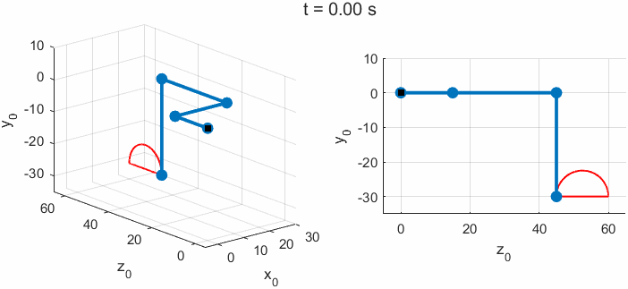
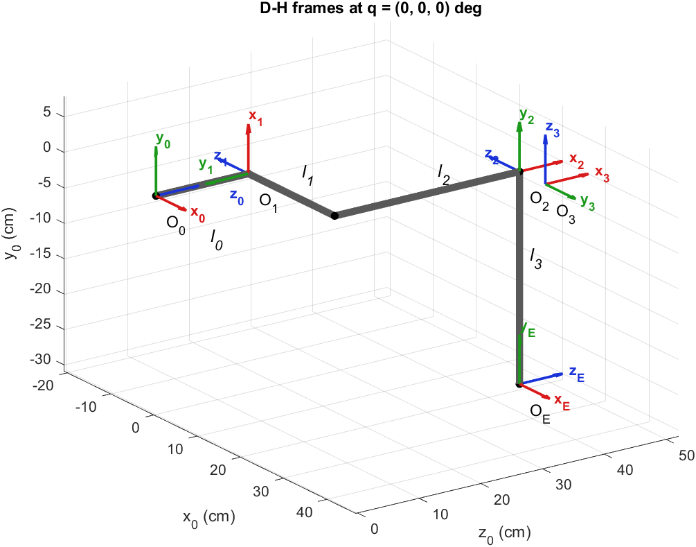
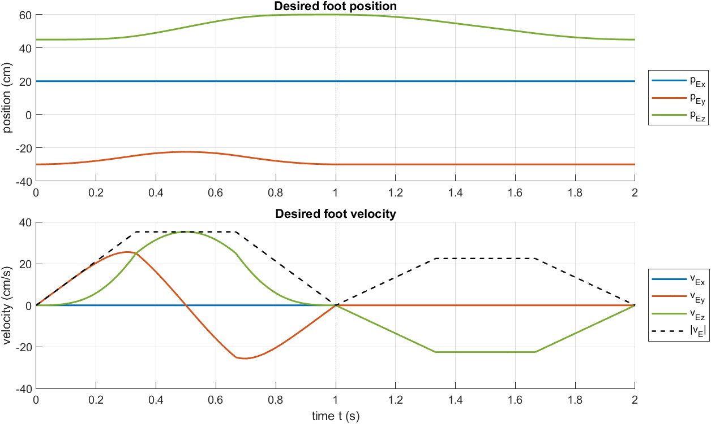
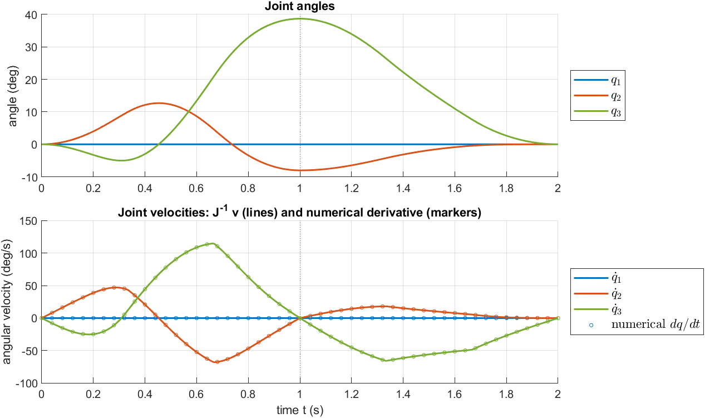
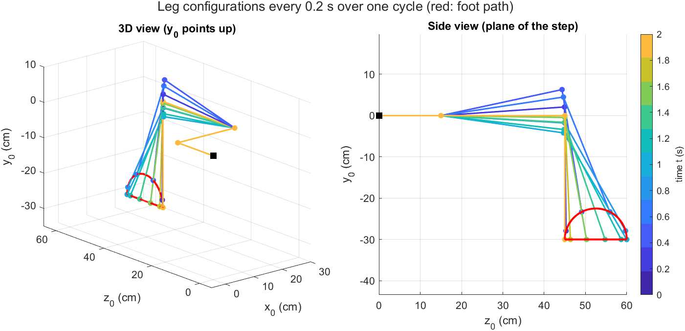
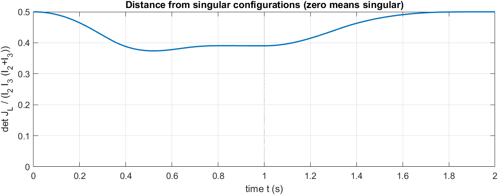

# Kinematics of a 3-DoF robotic leg (MATLAB)

Forward and inverse kinematics, the Jacobian and its singular configurations for a robotic leg with three rotational joints, and a kinematic simulation of one walking step.


This was the semester project of the course *Robotics I: Analysis, Control, Laboratory* (coursework, 2023-2024). Author: Konstantinos Vaios Chronis.

<p align="center"></p>

## Results at a glance

| Quantity | Value |
|---|---|
| Inverse kinematics | closed form, up to 4 solutions; max error 3.6·10⁻¹² cm over 5,000 random poses, all four solutions |
| Jacobian determinant | det J_L = l₂ l₃ cos q₃ (l₃ cos(q₂+q₃) − l₂ sin q₂) |
| Singular configurations | leg fully stretched or folded (q₃ = ±90°), or the foot on the cylinder of radius l₁ around the first joint axis |
| Step cycle | semicircle (swing) and straight line (stance), 1 s each, foot velocity continuous everywhere |
| Peak foot speed | 35.3 cm/s in the swing, 22.5 cm/s in the stance |
| Peak joint speed | 68.1 °/s (joint 2), 114.9 °/s (joint 3) |
| Tracking check | foot position from the computed joint angles matches the target to 1.8·10⁻¹⁴ cm |
| Distance from singularity | normalized det J_L ≥ 0.374 over the whole cycle |

## Contents

- [The task](#the-task)
- [What I did](#what-i-did)
- [Results](#results)
- [Repository structure](#repository-structure)
- [Getting started](#getting-started)
- [References](#references)
- [Sources and credits](#sources-and-credits)
- [License](#license)

## The task

The robot is one leg of a walking robot. From the base, a link of length l₀ runs along the axis of joint 1. A sideways offset l₁ leads to joint 2 (the hip), the thigh l₂ to joint 3 (the knee), and the shin l₃ to the foot. Joints 2 and 3 have parallel axes, at right angles to the axis of joint 1. The base frame has y₀ pointing up, so the walking surface is a horizontal plane. This summary is in English; the original statement is in Greek and is not included here.

**Part A: analysis.**

1. Place the Denavit-Hartenberg (D-H) frames and write the table of D-H parameters.
2. Find the forward kinematics: the foot position for given joint angles.
3. Find the Jacobian matrix.
4. Find the inverse differential kinematics for the linear velocity of the foot, and the singular configurations.
5. Find the inverse kinematics: the joint angles for a given foot position.

**Part B: simulation.** During a step the foot moves periodically between two points A and B on the walking surface. It first follows a semicircle from A over the top to B, in a vertical plane, and then a straight line from B back to A. At t = 0 the foot rests at A, the two segments take equal time, the period is T = 2 s, and the motion must be smooth, with at least a continuous velocity. The values are l₀ = 15 cm, l₁ = 20 cm, l₂ = l₃ = 30 cm, A = (20, −30, 45) cm and B = (20, −30, 60) cm, so the radius is R = 7.5 cm.

6. Design the foot trajectory.
7. Simulate the motion and plot the foot position and velocity, the joint angles and joint velocities, and snapshots of the leg during the motion.

Optionally, the walking parameters (for example the centre and radius of the semicircle) can be given by the user, with checks on the allowed range.

**In plain words.** *Forward kinematics* answers "where is the foot if the joints are at these angles?". *Inverse kinematics* answers the opposite question. The *Jacobian* links joint speeds to foot speed. A *singular configuration* is a pose in which the leg momentarily cannot move the foot in some direction, and the joint speeds needed to do so would blow up.

## What I did

### Part A: kinematic model

**D-H parameters.** Frame {0} is at the base, with z₀ on the axis of joint 1. Frames {1} and {2} have z₁ and z₂ on the axes of joints 2 and 3, and the foot frame {E} is parallel to {0} when q = 0.

| i | θᵢ | dᵢ | aᵢ | αᵢ |
|---|---|---|---|---|
| 1 | q₁ + 90° | l₀ | 0 | −90° |
| 2 | q₂ − 90° | −l₁ | l₂ | 0 |
| 3 | q₃ | 0 | 0 | −90° |
| E | 90° | −l₃ | 0 | 90° |

<p align="center"></p>

**Forward kinematics.** With K = l₃ cos(q₂+q₃) − l₂ sin q₂ and H = l₂ cos q₂ + l₃ sin(q₂+q₃):

```
p_x = l₁ cos q₁ + K sin q₁
p_y = l₁ sin q₁ − K cos q₁
p_z = l₀ + H
```

At q = 0 this gives (l₁, −l₃, l₀ + l₂) = (20, −30, 45) cm, which is exactly point A.

**Jacobian and singularities.** The linear part of the Jacobian factorizes neatly: det J_L = l₂ l₃ cos q₃ · K. The leg is singular when q₃ = ±90°, where the thigh and shin line up (fully stretched or fully folded), or when K = 0. K = 0 is the same as p_x² + p_y² = l₁², so the foot lies on the cylinder of radius l₁ around the axis of joint 1. There no joint can move the foot directly away from or towards that axis. The report also gives J_L⁻¹ in closed form.

**Inverse kinematics.** Comparing the last columns of (A₁⁰)⁻¹ T_E⁰ and A₂¹ A₃² A_E³ gives three equations. The first, l₁ = p_x cos q₁ + p_y sin q₁, gives q₁ through the half-angle substitution. Squaring and adding the other two gives sin q₃, and a 2 × 2 linear system then gives q₂. There are up to four solutions: two for q₁ times two for the knee. The code picks the one with q = 0 at point A.

`matlab/derivation_check.m` checks every Part A formula symbolically, and the inverse kinematics numerically on 5,000 random poses.

### Part B: trajectory and simulation

Each half of the cycle uses a path parameter σ(t) that goes from 0 to 1 with a **trapezoidal speed profile**: constant acceleration for the first third, constant speed, and constant deceleration for the last third.

- Swing: the foot follows the semicircle by its angle, p = (x_A, y_C + R sin πσ, z_C − R cos πσ).
- Stance: the foot follows the straight line p = p_B + σ (p_A − p_B).

Because σ̇ = 0 at both ends of each segment, the foot is at rest at A and B, and the velocity is continuous over the whole cycle and from one cycle to the next. The semicircle is followed by its angle, not by z: written as a function of z, the vertical speed would jump at A and B. For each sample (1 ms) the code solves the inverse kinematics for q(t) and computes the joint velocities as q̇ = J_L⁻¹ v(t).

## Results

All numbers come from `matlab/run_simulation.m` with the default task. The printed summary is in `results/simulation_summary.txt`.

<p align="center"></p>

The foot rises 7.5 cm above the walking surface. Its speed follows the trapezoidal profile, with peaks of 35.3 cm/s on the semicircle (πR × 1.5 s⁻¹) and 22.5 cm/s on the line. Every velocity component is continuous and zero at t = 0, 1 and 2 s.

<p align="center"></p>

Joint 1 stays at q₁ = 0, as it should: the step lies in the plane x₀ = 20 cm = l₁, which joints 2 and 3 alone can reach. q₂ ranges from −8.0° to 12.7° and q₃ from −5.0° to 38.7°. The fastest joint motion, 114.9 °/s at the knee, comes at t ≈ 0.67 s, at the end of the constant-speed part of the swing, when the foot comes down quickly towards B. The joint velocities from J_L⁻¹ v (lines) agree with the numerical derivative of the angles (markers) to 6.8·10⁻⁴ rad/s.

<p align="center"></p>

<p align="center"></p>

The leg stays far from singular configurations: |cos q₃| ≥ 0.78, |K| ≥ 22.5 cm, and the normalized determinant never drops below 0.374.

**Custom walking parameters.** `run_simulation` takes the walking parameters as arguments and checks every sample: it stops with an error message if a point is out of reach or the leg comes close to a singular configuration (normalized det J_L below 0.01). For example, R = 9 cm and T = 3 s lower the peak foot speed to 28.3 cm/s. A centre at (20, −30, 75) cm with R = 10 cm is rejected, because part of the path lies outside the workspace, and R = 29.9 cm is rejected because the leg gets too close to a singular configuration. With the centre in the plane x_C = 10 cm, joint 1 also moves, between −30.4° and −20.8°.

## Repository structure

```
robotic-leg-kinematics/
├── README.md
├── matlab/
│   ├── leg_params.m          link lengths and walking parameters, with checks
│   ├── fk_leg.m              forward kinematics from the D-H table
│   ├── jacobian_leg.m        linear Jacobian and its determinant
│   ├── ik_leg.m              closed-form inverse kinematics (four branches)
│   ├── trajectory_leg.m      semicircle + straight line, trapezoidal profile
│   ├── run_simulation.m      simulation, checks, figures and animation
│   ├── plot_frames.m         figure of the D-H frames
│   └── derivation_check.m    symbolic check of Part A, numeric check of the inverse kinematics
├── figures/                  figures and the animated GIF (made by run_simulation)
├── results/                  printed output of the two scripts
└── report/
    └── robotic-leg-kinematics_report_GR.pdf   report in Greek (9 pages)
```

## Getting started

You need MATLAB (tested with R2024b). `derivation_check.m` also needs the Symbolic Math Toolbox; the simulation itself needs no toolbox.

```matlab
cd matlab
run_simulation                                   % default task, saves figures and results
S = run_simulation('R', 9, 'T', 3, 'save', false);   % custom step, figures only
derivation_check                                 % symbolic check of Part A
```

## References

- J. Denavit and R. S. Hartenberg, *A kinematic notation for lower-pair mechanisms based on matrices*, ASME Journal of Applied Mechanics 22, 1955, 215-221.
- B. Siciliano, L. Sciavicco, L. Villani and G. Oriolo, *Robotics: Modelling, Planning and Control*, Springer, 2009 (D-H convention, Jacobian, singularities, trajectory planning).
- M. W. Spong, S. Hutchinson and M. Vidyasagar, *Robot Modeling and Control*, 2nd ed., Wiley, 2020.

## Sources and credits

- **Assignment.** The task is the semester project of the course *Robotics I: Analysis, Control, Laboratory* (2023-2024). The problem statement belongs to the course and is not included here. This README only summarizes it.
- **Own work.** The kinematic analysis, the MATLAB code, the figures and the report are the author's own work for this project.
- **Tools.** [MATLAB](https://www.mathworks.com/products/matlab.html) with the Symbolic Math Toolbox; the report was written in Microsoft Word.

## License

None. This work is shared for viewing only, and all rights are reserved by the author.
